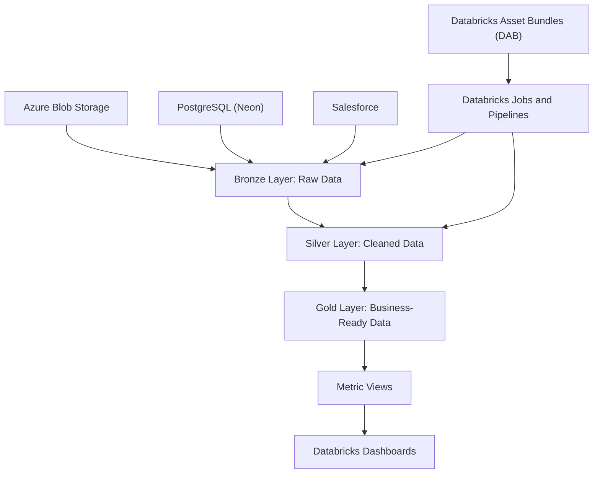

# RetailQ — End-to-End Retail Data Engineering Pipeline

An end-to-end retail data engineering project built using Databricks, PySpark, Delta Lake, and Databricks Asset Bundles (DAB).

The project integrates data from multiple sources, processes it through a Bronze–Silver–Gold architecture, and prepares curated datasets for analytics and business reporting.

## Project Overview

Retail analytics often requires data from different systems and formats. RetailQ brings these sources into a unified data pipeline with structured ingestion, transformation, orchestration, and reporting.

### Key Objectives

- Integrate data from multiple source systems.
- Organize data processing using the Medallion Architecture.
- Build reusable and maintainable data pipelines.
- Automate pipeline deployment and orchestration using Databricks Asset Bundles.
- Prepare curated data and metrics for dashboards and analytics.

## Architecture




## Technology Stack

| Technology | Purpose |
|---|---|
| Databricks | Data engineering and processing platform |
| PySpark | Distributed data transformations |
| Delta Lake | Reliable table storage and data processing |
| Databricks Asset Bundles (DAB) | Project configuration and deployment |
| Databricks CLI | Bundle validation, planning, and deployment |
| Azure Blob Storage | File-based data ingestion |
| PostgreSQL (Neon) | Relational data source |
| Salesforce | CRM data source |
| Unity Catalog | Data governance and access management |
| Lakeflow Spark Declarative Pipelines | Managed data pipeline processing |
| Databricks SQL | Metrics and analytics |
| Git and GitHub | Version control and source management |


## Key Features

- **Multi-source ingestion:** Integrates data from Azure Blob Storage, PostgreSQL (Neon), and Salesforce.
- **Medallion architecture:** Separates raw, cleaned, and business-ready data into Bronze, Silver, and Gold layers.
- **PySpark transformations:** Implements data processing logic for retail entities and sales data.
- **Pipeline orchestration:** Uses Databricks jobs and Lakeflow Spark Declarative Pipelines to organize processing workflows.
- **Declarative deployment:** Uses Databricks Asset Bundles (DAB) to manage project resources and development deployments.
- **Analytics and reporting:** Includes metric views and Databricks dashboard definitions.
- **Version control:** Tracks project code and configuration using Git and GitHub.

## Data Processing Layers

### Bronze — Raw Data

- Ingest data from the configured source systems.
- Preserve source data for downstream processing.
- Organize ingested datasets in the appropriate catalog and schema.

### Silver — Cleaned and Transformed Data

- Apply data cleaning and transformation logic.
- Standardize and prepare records for downstream use.
- Build reusable transformation pipelines.

### Gold — Business-Ready Data

- Prepare curated datasets for analytics.
- Support reporting, metric views, and dashboards.
- Make processed data easier to consume for business analysis.

## Repository Structure

```text
retailq_dab/
├── dashboards/       # Databricks dashboard definitions
├── fixtures/         # Test and development fixtures
├── resources/        # DAB pipeline and job configurations
├── src/              # Ingestion and transformation code
├── tests/            # Test configuration and tests
├── databricks.yml    # Bundle configuration and targets
├── pyproject.toml    # Python project configuration
├── .gitignore        # Files excluded from Git
└── README.md         # Project documentation
```

## Getting Started

### Prerequisites

- Access to a Databricks workspace.
- Databricks CLI installed.
- An authenticated Databricks CLI profile.
- Appropriate permissions for the configured catalog, schemas, and resources.
- Access to the source systems required by the pipelines.

### Validate the Development Bundle

```bash
databricks bundle validate -t dev --profile RETAILQ_DEV
```

### Review the Deployment Plan

```bash
databricks bundle plan -t dev --profile RETAILQ_DEV
```

### Deploy to Development

```bash
databricks bundle deploy -t dev --profile RETAILQ_DEV
```

Review the deployment plan before deploying. These commands target the development environment; do not deploy to production without reviewing the configuration and obtaining the required authorization.

## Project Highlights

- Multi-source retail data integration.
- Bronze–Silver–Gold data architecture.
- PySpark-based transformation code.
- Declarative pipeline and job configuration.
- Version-controlled Databricks project deployment.
- Curated metrics and dashboards for analytics.

## Author

**Sahil N. Sankeshwari**

GitHub: [SahilSankeshwari](https://github.com/SahilSankeshwari)
