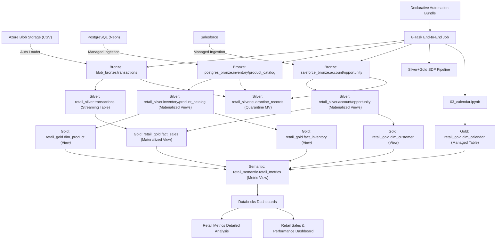

# RetailQ — End-to-End Retail Data Engineering Pipeline

An end-to-end retail data engineering project built using Databricks, PySpark, Delta Lake, Lakeflow Spark Declarative Pipelines (SDP), and Declarative Automation Bundles (DABs).

The project integrates data from Azure Blob Storage, PostgreSQL (Neon), and Salesforce, processes it through a Bronze–Silver–Gold medallion architecture, and delivers curated datasets for analytics dashboards.

## 1. Project Overview and Objectives

RetailQ brings data from three disparate source systems into a unified pipeline with structured ingestion, transformation, orchestration, and reporting.

**Key objectives:**

* Integrate data from multiple source systems (Blob Storage, PostgreSQL, Salesforce)
* Organize data processing using the Medallion Architecture (Bronze → Silver → Gold)
* Build reusable, maintainable, and idempotent data pipelines
* Automate pipeline deployment and orchestration using Declarative Automation Bundles
* Deliver curated metrics and dashboards for business analytics

## 2. Architecture and Data-Flow Diagram



## 3. Source Systems and Data Layers

### Source Systems

| Source | System | Ingestion Method | Data |
|---|---|---|---|
| Azure Blob Storage | CSV files in Unity Catalog Volume | Auto Loader (notebook) | Transactions (append-only) |
| PostgreSQL (Neon) | Managed ingestion pipeline | Cursor-based incremental | Inventory (SCD Type 1), Product Catalog (SCD Type 2) |
| Salesforce | Managed ingestion pipeline | CDC-style apply-changes | Account (SCD Type 2), Opportunity (upsert) |

### Bronze Layer (Raw Data)

* `blob_bronze.transactions` — Auto Loader append-only, managed table. Columns: transaction_id, opportunity_name, product_id, store_id, quantity, selling_price, discount_amount, transaction_timestamp (string), payment_mode, sales_channel, \_source_file, \_ingestion_timestamp.
* `postgres_bronze.inventory` — SCD Type 1 streaming table (cursor: last_stock_update).
* `postgres_bronze.product_catalog` — SCD Type 2 streaming table (cursor: updated_at, \_\_START\_AT/\_\_END\_AT columns).
* `saleforce_bronze.account` — SCD Type 2 streaming table (\_\_START\_AT/\_\_END\_AT columns).
* `saleforce_bronze.opportunity` — Upsert streaming table (MERGE/DELETE change commits).

### Silver Layer (Cleaned and Transformed)

| Table | Type | Read Mode | Key Transformations |
|---|---|---|---|
| `retail_silver.transactions` | Streaming Table | `readStream` from blob_bronze | Cast types, parse timestamp, 7 data-quality rules (2 enforceable, 5 warning-only) |
| `retail_silver.inventory` | Materialized View | Batch `read.table` from postgres_bronze | Column selection, inventory_status derived column |
| `retail_silver.product_catalog` | Materialized View | Batch `read.table` from postgres_bronze | Column selection, is_active filter not applied (full SCD2) |
| `retail_silver.account` | Materialized View | Batch `read.table` from saleforce_bronze | Full recompute picks up CDC changes |
| `retail_silver.opportunity` | Materialized View | Batch `read.table` from saleforce_bronze | Full recompute picks up CDC changes |
| `retail_silver.quarantine_records` | Materialized View | Batch from all 5 bronze sources | Centralized quarantine for enforceable (expect\_or\_drop) rejections. record\_data as VARIANT with nulls preserved. |

**Data-quality design:**

* Enforceable rules (`@dp.expect_or_drop`) reject invalid rows — captured in `quarantine_records`.
* Warning-only rules (`@dp.expect`) log violations but retain rows in Silver.
* Materialized views (batch read) pick up bronze MERGE/DELETE change commits on each refresh — idempotent and rerun-safe.
* Streaming table (transactions) uses append-only `readStream` — exactly-once via checkpoint.

### Gold Layer (Business-Ready Data)

| Table | Type | Description |
|---|---|---|
| `retail_gold.fact_sales` | Materialized View | LEFT join of silver.transactions + silver.opportunity (by normalized name). Dedup guard prevents fanout. |
| `retail_gold.dim_calendar` | Managed Table | Calendar dimension (2025-2030). Created by notebook with `CREATE OR REPLACE TABLE`. |
| `retail_gold.dim_customer` | View | From silver.account, filtered by is\_deleted=false and is\_active=true. |
| `retail_gold.dim_product` | View | From silver.product\_catalog, filtered by is\_active=true. |
| `retail_gold.fact_inventory` | View | From silver.inventory, direct selection. |

### Semantic Layer

`retail_semantic.retail_metrics` — A UC metric view built on fact\_sales with joins to dim\_product, dim\_calendar, and dim\_customer. Provides 15 dimensions and 6 measures for dashboard analytics.

## 4. Technology Stack

| Technology | Purpose |
|---|---|
| Databricks | Data engineering and processing platform |
| PySpark | Distributed data transformations |
| Delta Lake | Reliable table storage |
| Declarative Automation Bundles (DABs) | Project configuration and deployment |
| Databricks CLI | Bundle validation, planning, and deployment |
| Azure Blob Storage (via UC Volumes) | File-based data ingestion |
| PostgreSQL (Neon) | Relational data source |
| Salesforce | CRM data source |
| Unity Catalog | Data governance and access management |
| Lakeflow Spark Declarative Pipelines (SDP) | Managed silver/gold pipeline processing |
| Databricks SQL (Metric Views) | Semantic layer for analytics |
| AI/BI Dashboards | Business intelligence and reporting |
| Git and GitHub | Version control and CI/CD |
| Ruff | Python linting and formatting |
| pytest | Unit testing |
| uv | Python dependency management |

## 5. Repository Structure

```text
retailq_dab/
├── .github/workflows/
│   ├── ci.yml                              # CI: unit tests + ruff linting/formatting
│   └── deploy.yml                          # Manual deployment (dev or prod)
├── .vscode/
│   ├── extensions.json                     # Recommended VS Code extensions
│   └── settings.json                        # VS Code workspace settings
├── dashboards/
│   ├── Retail Metrics Detailed Analysis.lvdash.json
│   └── Retail Sales & Performance Dashboard.lvdash.json
├── fixtures/
│   └── .gitkeep                             # Placeholder for test fixtures
├── resources/
│   ├── postgres_to_bronze.pipeline.yml      # PostgreSQL managed ingestion pipeline
│   ├── retailq_end_to_end_job.job.yml       # 8-task orchestration job
│   ├── retail_transformation_v2.pipeline.yml # Silver+Gold SDP pipeline
│   └── saleforce_to_bronze.pipeline.yml     # Salesforce managed ingestion pipeline
├── src/
│   ├── __init__.py
│   ├── 01_blob_to_bronze.ipynb              # Auto Loader: CSV → Delta bronze
│   ├── 02_Gold_Views.ipynb                  # Gold dimension/fact views
│   ├── 03_calendar.ipynb                    # Calendar dimension table (active)
│   ├── 03_calendar.py                       # Deprecated SDP calendar definition (not in pipeline)
│   ├── 04_Metric_view.ipynb                 # Semantic metric view
│   └── retail_transformation_v2/
│       ├── __init__.py
│       ├── bronze_to_silver/
│       │   ├── __init__.py
│       │   ├── account.py                   # Salesforce account → silver MV
│       │   ├── inventory.py                 # PostgreSQL inventory → silver MV
│       │   ├── opportunity.py              # Salesforce opportunity → silver MV
│       │   ├── product_catalog.py          # PostgreSQL product_catalog → silver MV
│       │   ├── quarantine.py               # Centralized quarantine MV
│       │   └── transactions.py             # Blob transactions → silver ST
│       └── silver_to_gold/
│           ├── __init__.py
│           └── fact_sales.py               # Gold fact_sales MV
├── tests/
│   └── conftest.py                          # Integration test config (Databricks Connect)
├── unit_tests/
│   ├── conftest.py                          # Unit test config
│   ├── cleaning.py                          # Utility: string cleaning
│   ├── data_quality.py                     # Utility: transaction validation
│   ├── product_transform.py               # Utility: product transformation (requires PySpark)
│   ├── test_cleaning.py                    # Tests for cleaning.py
│   ├── test_data_quality.py               # Tests for data_quality.py
│   ├── test_product_transform.py          # Tests for product_transform.py
│   └── test_project_setup.py              # Tests for project configuration
├── .gitignore
├── AGENTS.md                               # AI agent instructions
├── CLAUDE.md                               # Claude Code import of AGENTS.md
├── CONTRIBUTING.md                         # Contribution guidelines
├── README.md                               # This file
├── databricks.yml                          # Bundle configuration (dev + prod targets)
├── pyproject.toml                          # Python project config (ruff, pytest)
├── pytest-unit.ini                         # Unit test configuration
└── uv.lock                                 # Locked dependencies
```

## 6. Prerequisites and Python Version

* Python 3.12 (requires-python `>=3.12,<3.13`)
* [uv](https://docs.astral.sh/uv/) for dependency management
* [Databricks CLI](https://docs.databricks.com/dev-tools/cli/install) installed and authenticated
* Access to a Databricks workspace with serverless compute enabled
* Appropriate Unity Catalog permissions for the target catalog and schemas
* Access to configured source systems (Blob Storage volume, PostgreSQL connection, Salesforce connection)

## 7. Dependency Installation

```bash
# Install uv (if not already installed)
curl -LsSf https://astral.sh/uv/install.sh | sh

# Install Python and project dependencies
uv python install 3.12
uv sync --group dev
```

## 8. Authentication and Secret Management

* The Databricks CLI is pre-authenticated in the Databricks workspace environment.
* For local development, authenticate using `databricks auth login` or a `.databrickscfg` profile.
* **Never commit passwords, access tokens, client secrets, or connection strings to Git.** The `.gitignore` excludes `.databrickscfg`, `.env`, and key files.
* CI/CD uses GitHub Actions secrets (`DATABRICKS_HOST`, `DATABRICKS_TOKEN`) for the deploy workflow.
* Source system connections (PostgreSQL, Salesforce) are managed as Unity Catalog connections in the Databricks workspace — not stored in code.

## 9. Development Configuration

The development target uses:

* **Catalog:** `retail_q_dab_dev`
* **Schema:** `${workspace.current_user.short_name}` (reserved for future use; data-layer schemas are hardcoded by design)
* **Deployment path:** `/Workspace/Users/<user>/.bundle/retailq_dab/dev`
* **Mode:** `development` (auto-prefixes resources with `[dev <username>]`, pauses schedules)
* **Job name:** `RetailQ End to End Job - DAB Dev` (becomes `[dev <username>] RetailQ End to End Job - DAB Dev`)
* **Dashboard ID:** `01f1c30de7af169cb2e0e236050b29fb`

## 10. Bundle Validation and Dev Deployment Commands

```bash
# Validate the development bundle
databricks bundle validate -t dev

# Review the deployment plan
databricks bundle plan -t dev

# Deploy to development (creates/updates resources in the dev catalog)
databricks bundle deploy -t dev
```

Review the deployment plan before deploying. These commands target the development environment only — do not deploy to production without reviewing the configuration and obtaining explicit authorization.

## 11. How to Run and Monitor the Dev Job

After deploying the dev bundle:

1. Navigate to the **Jobs** page in the Databricks workspace.
2. Find the job named `[dev <username>] RetailQ End to End Job - DAB Dev`.
3. Click **Run now** to trigger a full pipeline run.
4. Monitor task progress in the job run view — all 8 tasks should succeed.

**Job ID (dev):** 467893636440870

**Expected runtime:** approximately 6–10 minutes depending on compute availability.

## 12. Task Dependency Sequence

The job has 8 tasks with the following dependency chain:

```text
blob_to_bronze (notebook)     ─┐
postgres_to_bronze (pipeline)  ├──→ Data_Processing_and_Reporting_Pipeline (SDP pipeline)
saleforce_to_bronze (pipeline) ─┘         │
                                          ├──→ Refresh_Calendar (notebook)
                                          │         │
                                          │         ├──→ Refresh_Gold_Views (notebook)
                                          │                   │
                                          │                   ├──→ Refresh_Metric_View (notebook)
                                          │                             │
                                          │                             ├──→ Business_Insights_Dashboard (dashboard)
```

**Retry settings:**

* `postgres_to_bronze`, `saleforce_to_bronze`, `Data_Processing_and_Reporting_Pipeline`: max\_retries=2, min\_retry\_interval=300000ms (5 min)
* `blob_to_bronze`: no retries (notebook task)
* `max_concurrent_runs`: 1
* `email_notifications`: on\_failure to the owner

## 13. Tests and Ruff Commands

```bash
# Run unit tests (no Databricks connection needed for most tests)
uv run pytest --noconftest -c pytest-unit.ini unit_tests -v

# Check code quality (linting)
uv run ruff check src/ unit_tests/ tests/

# Check formatting
uv run ruff format --check src/ unit_tests/ tests/

# Auto-fix linting issues
uv run ruff check --fix src/ unit_tests/ tests/

# Auto-format code
uv run ruff format src/ unit_tests/ tests/
```

**Known limitation:** `unit_tests/test_product_transform.py` imports PySpark functions and requires a local PySpark installation or Databricks Connect session. On Databricks serverless compute without a cluster, this test module fails at import time. The other 11 tests pass without any Databricks connection.

## 14. Dashboard and Metric-View Details

### Metric View: `retail_semantic.retail_metrics`

A UC metric view built on `retail_gold.fact_sales` with joins to:

* `dim_product` (on product\_id)
* `dim_calendar` (on transaction\_date)
* `dim_customer` (on customer\_id)

**15 dimensions:** Transaction Date, Year, Quarter, Month Name, Product Category, Product Brand, Payment Mode, Sales Channel, Stage Name, Customer Type, Customer Name, Billing City, Billing State, Billing Country, Industry.

**6 measures:** Transaction Count (COUNT), Total Revenue (SUM(amount)), Total Quantity Sold (SUM(quantity)), Total Discount (SUM(discount\_amount)), Average Transaction Value (SUM(amount)/COUNT(1)), Unique Customers (COUNT(DISTINCT customer\_id)).

### Dashboards

| Dashboard | Description |
|---|---|
| Retail Metrics Detailed Analysis | 20 widgets, 1 page, 1 dataset. KPI cards + charts using the metric view. |
| Retail Sales & Performance Dashboard | 2 pages (main + global filters), 31 widgets. KPI cards + charts with INR currency formatting. |

Dashboard definitions are stored in `dashboards/*.lvdash.json` for version control. The job's `Business_Insights_Dashboard` task refreshes the dashboard subscription.

## 15. Troubleshooting and Safe Recovery

### Common Issues

* **Serverless compute limits:** Free Edition workspaces have concurrency limits. If ingestion pipelines fail with `CLUSTER_CREATION_RESOURCE_EXHAUSTED` or `ACTIVE_RUNS_LIMIT_REACHED`, wait for capacity and re-run the job. Retry settings (max\_retries=2) handle transient failures automatically.
* **Streaming checkpoint errors:** If the silver transactions streaming table reports `DIFFERENT_DELTA_TABLE_READ_BY_STREAMING_SOURCE`, run a full pipeline refresh (`full_refresh=True`) to clear streaming checkpoints and rebuild from bronze.
* **Schema evolution errors:** If bronze schema changes break silver reads, use `CREATE OR REPLACE TABLE` for managed tables and selective/full refresh for pipeline tables.
* **Calendar table conflicts:** The calendar notebook uses `CREATE OR REPLACE TABLE` — safe to re-run. If a pipeline-managed calendar table exists with a different type, drop it first.

### Safe Recovery Steps

1. Check job run details for failed tasks and error messages.
2. Inspect pipeline update events in the pipeline monitoring page.
3. Verify bronze table counts match expected values.
4. Run a selective or full pipeline refresh if silver/gold tables are stale.
5. Re-run the job after resolving the root cause.

## 16. Production Configuration Placeholders

The `prod` target in `databricks.yml` is **prepared but not deployed or runtime-validated**. Before deploying to production:

* **`catalog`:** `retail_q` — verify this catalog exists and the deploying user has `USE CATALOG` permission.
* **`schema`:** `prod` — currently unused (data-layer schemas are hardcoded).
* **`job_name`:** `RetailQ End to End Job` — verify this name does not conflict with existing jobs.
* **`dashboard_id`:** `""` (empty) — **must be set** to a production dashboard UUID before deploying.
* **`root_path`:** `/Workspace/Users/<user>/.bundle/retailq_dab/prod` — production deployment path.
* **Connection names:** `neon_postgres_retail_project` and `saleforce_to_bronze` — verify these connections exist in the production workspace.
* **Pipeline schemas:** `retail_silver`, `postgres_bronze`, `saleforce_bronze` — verify these schemas exist under the `retail_q` catalog.

## 17. Dev-to-Prod Promotion Checklist

**This checklist requires separate explicit approval before proceeding.**

1. [ ] Verify the production catalog `retail_q` exists and has the required schemas.
2. [ ] Set `dashboard_id` in the prod target to a valid production dashboard UUID.
3. [ ] Verify Unity Catalog connections (`neon_postgres_retail_project`, `saleforce_to_bronze`) exist in production.
4. [ ] Confirm the deploying user has `CAN_MANAGE` permission on the prod target resources.
5. [ ] Run `databricks bundle validate -t prod` — must pass.
6. [ ] Review `databricks bundle plan -t prod` — confirm no unintended changes.
7. [ ] Deploy: `databricks bundle deploy -t prod`.
8. [ ] Trigger a production job run and verify all 8 tasks succeed.
9. [ ] Validate production data counts against expected values.
10. [ ] Set up monitoring and alerting for the production job.
11. [ ] Document the production job ID and resource IDs.

**Do NOT deploy to production without completing every item above.**

## 18. Security, Permissions, and Operational Considerations

* **Secrets:** Never store passwords, tokens, or connection strings in code. Use Unity Catalog connections and Databricks secrets.
* **Permissions:** The prod target grants `CAN_MANAGE` to `sankeshwarisahil2003@gmail.com`. Adjust permissions for production team access before deploying.
* **Data isolation:** Dev and prod use separate catalogs (`retail_q_dab_dev` vs `retail_q`). The bundle's `${var.catalog}` variable ensures all resources target the correct catalog.
* **Idempotency:** All Silver materialized views use full recompute (batch read) — safe to re-run without duplicates. The transactions streaming table uses checkpoint-based exactly-once processing.
* **Quarantine:** Enforceable data-quality rejections are captured in `retail_silver.quarantine_records` with full record data (VARIANT) for audit and reprocessing.
* **CDC limitations:** PostgreSQL cursor-based ingestion does not propagate deletes (documented in `inventory.py` and `product_catalog.py`). Salesforce CDC is runtime-verified for updates and deletes.
* **Join risk:** `fact_sales` joins transactions to opportunities by normalized name (no source `opportunity_id` available). A dedup guard prevents row fanout. Recommended fix: add `opportunity_id` to the CSV export.
* **CI/CD:** The CI workflow runs unit tests and ruff checks on every push/PR. The deploy workflow is manual dispatch only (dev or prod).
* **Git workflow:** Never push directly to `main`. Create a feature branch, open a PR, and merge after review.

## Author

**Sahil N. Sankeshwari**

GitHub: [SahilSankeshwari](https://github.com/SahilSankeshwari)
